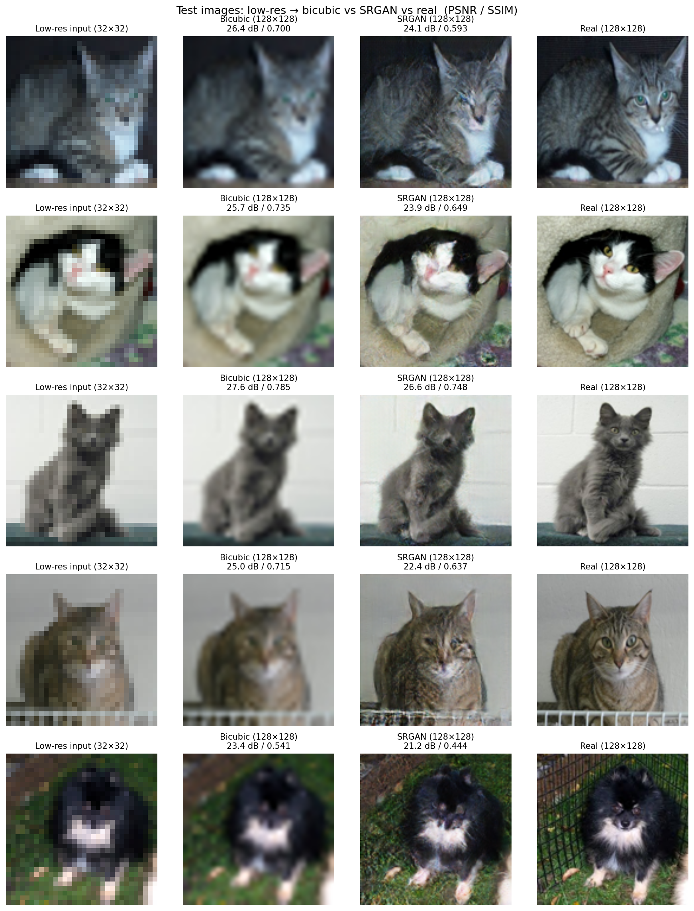
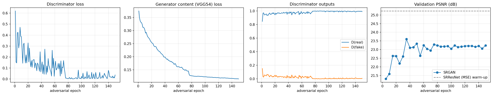
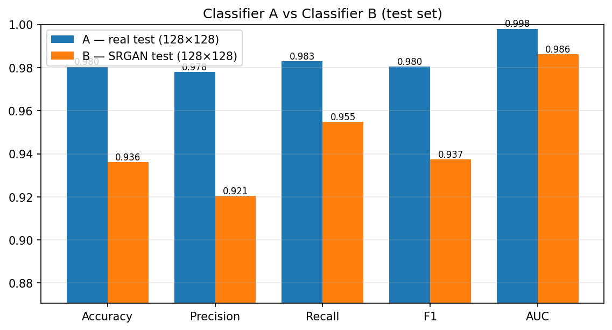

# Applied AI Mid-Term — SRGAN Super-Resolution for Dogs vs. Cats Classification

**Student:** Ramisa Farha · rfarha@charlotte.edu
**Notebook:** [`SRGAN_Midterm_rfarha.ipynb`](SRGAN_Midterm_rfarha.ipynb) (Google Colab, TensorFlow 2.x / Keras 3, T4 GPU)
**Dataset:** [Dogs vs. Cats Classification — Kaggle](https://www.kaggle.com/datasets/blourdhuraju/dogs-vs-cats-classification)
**Paper implemented:** C. Ledig et al., *Photo-Realistic Single Image Super-Resolution Using a Generative Adversarial Network*, CVPR 2017 — [arXiv:1609.04802](https://arxiv.org/abs/1609.04802)

---

## 1. What this project does

Assignment 1 built a cat-vs-dog classifier with MobileNetV2 transfer learning. This project asks whether a **Super-Resolution GAN (SRGAN)** can rebuild usable images from heavily downscaled ones:

```
                       ┌──────────────────────── Classifier A (MobileNetV2) ── trained/tested on real images (128×128)
original photo ─► 128×128 ┤
                       └─► 32×32 ─► SRGAN generator ─► 128×128 ─► Classifier B (MobileNetV2) ── trained/tested on SRGAN images (128×128)
```

* **Classifier A** — MobileNetV2 transfer learning on real images downscaled to **(128×128)**.
* **SRGAN** — trained to turn **(32×32)** images into **(128×128)** images (4× super-resolution), following the paper's generator, discriminator and VGG54 perceptual loss.
* **Classifier B** — the same MobileNetV2 recipe, trained on SRGAN-generated **(128×128)** images.
* Both classifiers are compared on the same 30% test split with **Accuracy, Precision, Recall, F1 and AUC**, plus ROC curves and confusion matrices.

### Exam requirements → where they are met

| Requirement | Where |
|---|---|
| Binary classifier A with transfer learning (as in Assignment 1), images downscaled to (128×128) | Notebook §3, §7 |
| SRGAN generating (128×128) images from training images downscaled to (32×32) | §8–§10 |
| Examples of scaled images shown in the notebook | §4 → `results/01_scaled_examples.png` |
| Classifier B trained on SRGAN-generated images | §11–§12 |
| SRGAN trained for at least 150 epochs | §10, `SRGAN_EPOCHS = 150` |
| 70% training / 30% testing split | §5 |
| Normalization and image transformation, with samples shown | §6 → `results/02_*.png`, `results/03_*.png` |
| Comparison with F1, Accuracy, AUC (and Precision, Recall) | §13 |
| Models saved every *n* epochs because of Colab GPU limits | §10 (`SAVE_EVERY = 5`, plus `srgan_backup.zip` for resuming in a new session), classifiers saved every epoch (§7) |

---

## 2. Repository layout

```
.
├── SRGAN_Midterm_rfarha.ipynb   # the complete pipeline (run top to bottom in Colab)
├── README.md                    # this document
├── requirements.txt             # package versions for running outside Colab
├── models/                      # trained models from the full run
│   ├── srgan_generator.weights.h5   # trained SRGAN generator (~6 MB)
│   ├── classifier_A.keras           # Classifier A (real images)
│   └── classifier_B.keras           # Classifier B (SRGAN images)
└── results/                     # figures, CSV metrics, training logs, results_summary.md
```

The discriminator and optimizer checkpoints (~400 MB, inside `srgan_backup.zip`) are only needed to resume training. They are not committed, because GitHub's file limit is 100 MB.

---

## 3. How to reproduce

### 3.1 Requirements
* A Google account for Colab. **Google Drive is not required.**
* A Colab **T4 GPU** runtime. Free Colab works. If training spans more than one session, you resume it from a backup zip (step 5).
* Nothing to install: Colab already has TensorFlow, Keras, scikit-learn, Pillow and `kagglehub`. For a local run, see `requirements.txt`.

### 3.2 Steps
1. Open `SRGAN_Midterm_rfarha.ipynb` in Colab (*File → Upload notebook*, or *Open in Colab* from GitHub).
2. Set *Runtime → Change runtime type → **T4 GPU***.
3. **Smoke test (recommended, ≈10 min):** in §1 set `SMOKE_TEST = True` and choose *Runtime → Run all*. This runs every stage on 600 images with 1–2 epochs each, in a separate `smoke_test/` folder. If it finishes without errors, the full run will too.
4. **Full run:** set `SMOKE_TEST = False` and choose *Runtime → Run all*. Everything is saved in `/content/AppliedAI_Midterm_SRGAN` (`USE_GOOGLE_DRIVE = False`).
5. **Resuming across Colab sessions (no Drive):** Colab deletes `/content` when a runtime ends. The notebook rebuilds `/content/srgan_backup.zip` (≈0.5 GB) after Classifier A, after Classifier B and at every SRGAN checkpoint (every 5 epochs). It holds the SRGAN checkpoint, the Adam optimizer states, the finished models and the results.
   * **Before the session ends:** download `srgan_backup.zip` from the Colab Files panel, or run notebook §15.
   * **Next session:** upload `srgan_backup.zip` to `/content`, then choose *Run all*. §1 unpacks it. Classifier A is not retrained, and SRGAN continues from its last saved epoch, at most `SAVE_EVERY − 1` epochs back. The dataset is re-downloaded and resized in a few minutes.
   * Alternatively, set `USE_GOOGLE_DRIVE = True` in §1 to save straight to Drive, so resuming needs no upload.
6. When §14 finishes, `repo_export.zip` is downloaded to your computer. Unzip it into this repository so that `models/` and `results/` sit next to the notebook. Copy the table from `results/results_summary.md` into §6 below.
7. In Colab, *File → Download → Download .ipynb* **with the outputs kept** and replace the notebook in the repo, so the graders can see every training log and figure.

### 3.3 Everything the notebook writes

```
/content/AppliedAI_Midterm_SRGAN/full_run/      (or MyDrive/AppliedAI_Midterm_SRGAN/full_run/ with USE_GOOGLE_DRIVE = True)
├── cache/images_128_32.npz              # all images at (128×128) and (32×32), uint8
├── cache/srgan_images_128.npz           # SRGAN output for every image at (128×128)
├── checkpoints/srgan/
│   ├── state.json                       # epochs done + loss history (resume point)
│   ├── generator_latest.weights.h5, discriminator_latest.weights.h5
│   ├── g_opt.npz, d_opt.npz, pre_opt.npz   # Adam optimizer state
│   ├── generator_srresnet_pretrained.weights.h5
│   └── generator_epoch_005.weights.h5 … generator_epoch_150.weights.h5
├── models/                              # classifiers (every epoch + best + final), final generator
└── results/                             # figures, CSV logs, metrics, srgan_progress/ images
```

### 3.4 Reproducibility settings
* One random seed (`SEED = 42`) for Python, NumPy, TensorFlow, the data split and the SRGAN subset.
* Image files are sorted before splitting, so the split is the same in every session.
* Exact duplicate images (same MD5 hash) are removed before splitting, so no picture can be in both train and test.
* GPU training is not bit-for-bit deterministic, so re-runs give *similar*, not identical, numbers.

---

## 4. Method

### 4.1 Data preparation (§2–§5)
1. The Kaggle dataset is downloaded with `kagglehub`. If that fails, the notebook uses a ZIP uploaded to `/content`.
2. Labels come from the filename (`cat.*`, `dog_*`) or from the parent folder (`cats/`, `dogs/`), as in Assignment 1. The dataset's own train/validation/test folders are pooled.
3. Unreadable files are skipped and byte-identical duplicates are removed.
4. Every image is resized to **(128×128)** (bicubic, anti-aliased). That image is then downscaled 4× to **(32×32)** with a bicubic kernel, which is how the paper creates its low-resolution inputs.
5. **Split:** stratified **70% train / 30% test**. Inside the 70%, 10% is held out as a validation set for early stopping, giving 63% / 7% / 30% of all images. The same indices are used for Classifier A, the SRGAN and Classifier B.

### 4.2 Normalization and transformation (§6)
* **Classifiers:** pixels are scaled from [0, 255] to **[-1, 1]** (`x / 127.5 − 1`, MobileNetV2's expected input). Training images are also randomly flipped horizontally, rotated ±20°, shifted ±10% and zoomed ±15% (the same augmentations as Assignment 1), using Keras preprocessing layers in a `tf.data` pipeline. Validation and test images are only normalized.
* **SRGAN:** low-res inputs are scaled to **[0, 1]** and high-res targets to **[-1, 1]**, as in the paper. Each LR/HR pair is flipped together at random.

### 4.3 Classifiers A and B (§7, §12)
Same recipe as Assignment 1, at (128×128):

| Setting | Value |
|---|---|
| Backbone | MobileNetV2, ImageNet weights, `include_top=False`, input (128×128×3) |
| Head | GlobalAveragePooling → Dropout 0.2 → Dense(1, sigmoid) |
| Stage 1 | backbone frozen, Adam 1e-3, 5 epochs |
| Stage 2 (fine-tuning) | last 30 backbone layers unfrozen (BatchNorm kept frozen), Adam 1e-5, 5 epochs |
| Batch size / loss | 32 / binary cross-entropy |
| Callbacks | EarlyStopping (val_loss, patience 2, restore best), ReduceLROnPlateau (×0.2, patience 1), ModelCheckpoint every epoch + best, CSVLogger |

The only difference between A and B is the input images: real (128×128) for A, SRGAN-generated (128×128) for B.

### 4.4 SRGAN (§8–§10)

| Component | Implementation (paper value in brackets where it differs) |
|---|---|
| Generator | 9×9 conv 64 + PReLU → **16 residual blocks** (conv-BN-PReLU-conv-BN + skip) → conv-BN + long skip → **2 × (conv 256 → PixelShuffle ×2 → PReLU)** → 9×9 conv 3, tanh. Input (32×32×3), output (128×128×3). ~1.5 M parameters |
| Discriminator | 3×3 conv 64 + LeakyReLU(0.2) → 7 × (conv → BN → LeakyReLU) with 64/2, 128/1, 128/2, 256/1, 256/2, 512/1, 512/2 filters/stride → Dense 1024 → LeakyReLU → Dense 1. Input (128×128×3) |
| Content loss | **VGG54**: MSE between VGG19 `block5_conv4` features of real and generated images, features × 1/12.75 |
| Adversarial loss | −log D(G(LR)), weight **10⁻³** |
| Discriminator loss | binary cross-entropy, real = 1, generated = 0 (sigmoid folded into the loss with `from_logits=True`) |
| Warm-up | generator trained alone with pixel MSE (SRResNet) for 10 epochs [paper: 10⁶ updates], then used to initialise the GAN |
| Adversarial training | **150 epochs**, alternating D and G updates every batch (k = 1), batch 16 |
| Optimizer | Adam, β₁ = 0.9; learning rate 1e-4 for epochs 1–75, 1e-5 for epochs 76–150 [paper: 10⁵ updates at each rate] |
| Training images | random 5,000-image subset of the training split [paper: 350k ImageNet crops of (96×96)] |
| Checkpoints | every 5 epochs: G, D, both Adam states, epoch counter, loss history; plus a generator copy per checkpoint |

**Why a 5,000-image subset.** Every SRGAN step runs VGG19 on two (128×128) batches, so an epoch over the full ~15k-image training split takes several minutes on a T4, and 150 epochs would need several 12-hour Colab sessions. 5,000 images gives 312 updates per epoch (~47k adversarial updates in total) and fits in a few sessions. The notebook prints the measured seconds per epoch and the ETA at every checkpoint. Set `SRGAN_TRAIN_IMAGES = None` to train on the whole training split. The trained generator is then applied to **every** image (train, validation and test) to build Classifier B's dataset.

**No test leakage.** The SRGAN only ever sees images from the training split. Validation images are used only to monitor PSNR/SSIM during training. Test images are only passed through the finished generator.

### 4.5 Evaluation (§11, §13)
* **Image quality:** PSNR and SSIM (RGB, data range [0, 1]) of SRGAN and of bicubic enlargement against the real (128×128) test images, plus side-by-side examples.
* **Main comparison:** Classifier A on real test images vs Classifier B on SRGAN test images: Accuracy, Precision, Recall, F1, AUC, classification reports, confusion matrices and ROC curves.
* **Extra rows:** A on SRGAN images, B on real images (cross-domain), and A on bicubic-enlarged images (no-GAN reference).

---

## 5. Figures produced

| File | Content |
|---|---|
| `results/01_scaled_examples.png` | original → (128×128) → (32×32) |
| `results/02_transformed_samples.png` | original vs three random training transformations, (128×128) |
| `results/03_normalized_batch.png` | a normalized training batch and pixel-value histogram before/after |
| `results/classifier_A_training_curves.png`, `results/classifier_B_training_curves.png` | accuracy / loss per epoch |
| `results/04_srgan_training_curves.png` | D loss, VGG content loss, D(real)/D(fake), validation PSNR |
| `results/srgan_progress/*.png` | LR (32×32) / bicubic / SRGAN / real (128×128) every 5 epochs |
| `results/05_srgan_test_examples.png` | test-set examples with PSNR / SSIM |
| `results/06_classifier_inputs_A_vs_B.png` | what A and B are trained on |
| `results/07_confusion_matrices.png`, `results/08_roc_curves.png`, `results/09_metric_comparison.png` | final comparison |

---

## 6. Results

Full run on a Colab Tesla T4 (TensorFlow 2.21.0, Keras 3.13.2), executed top to bottom in one session with no errors.

**Data:** 24,930 images (12,472 cats, 12,458 dogs). No unreadable files and no duplicates. Train 15,705 / validation 1,746 / test 7,479 (70% / 30% split, validation taken from the 70%).
**SRGAN:** 10 SRResNet warm-up epochs + **150 adversarial epochs** on 5,000 training images, (32×32) → (128×128). About 141 s per adversarial epoch, roughly 6 h in total.

### Super-resolution quality on the test set (128×128, 7,479 images)

| Method | PSNR (dB) | SSIM |
|---|---|---|
| Bicubic (32×32 → 128×128) | 25.06 | 0.7071 |
| SRGAN (32×32 → 128×128) | 23.39 | 0.6293 |

### Classifier comparison on the test set (7,479 images)

| Model / test images | Accuracy | Precision | Recall | F1 | AUC |
|---|---|---|---|---|---|
| **A — real test (128×128)** | **0.9803** | 0.9779 | 0.9829 | **0.9804** | **0.9980** |
| **B — SRGAN test (128×128)** | **0.9362** | 0.9205 | 0.9548 | **0.9373** | **0.9862** |
| A — SRGAN test (cross) | 0.9318 | 0.9138 | 0.9534 | 0.9332 | 0.9839 |
| B — real test (cross) | 0.9775 | 0.9717 | 0.9837 | 0.9777 | 0.9979 |
| A — bicubic test (reference) | 0.8850 | 0.9586 | 0.8047 | 0.8749 | 0.9660 |
| B − A (main comparison) | −0.0441 | −0.0574 | −0.0281 | −0.0430 | −0.0118 |

Confusion matrices (rows = true cat / dog, columns = predicted cat / dog):
* **A:** cats 3,659 correct / 83 wrong · dogs 3,673 correct / 64 wrong → 147 errors
* **B:** cats 3,434 correct / 308 wrong · dogs 3,568 correct / 169 wrong → 477 errors





### Discussion

**1. Classifier B is good but below Classifier A.** B reaches 93.6% accuracy, 0.937 F1 and 0.986 AUC, against 98.0%, 0.980 and 0.998 for A: −4.4 points accuracy, −4.3 points F1, −0.012 AUC. B's images were rebuilt from only 1/16 of the pixels, so some information the SRGAN cannot recover is lost for good. B makes about 3× more mistakes than A (477 vs 147). Most of the extra mistakes are cats predicted as dogs (308 vs 83), which is why B's precision (0.921) falls more than its recall (0.955).

**2. SRGAN recovers detail that matters for classification, even though its PSNR is lower.** The SRGAN images score lower than bicubic on pixel metrics: 23.39 vs 25.06 dB PSNR, 0.629 vs 0.707 SSIM. This matches the paper's observation that GAN-based super-resolution trades pixel accuracy for realistic texture. For classification, though, the SRGAN images are clearly better. The same Classifier A scores 93.2% on SRGAN images but only 88.5% on bicubic images (+4.7 points), and its recall on bicubic images drops to 0.80 because blurry dogs get called cats. The example figure shows why: bicubic output is smooth and blurry, while SRGAN restores fur texture, whiskers and sharp edges.

**3. The generated textures are plausible, not exact.** In the examples the SRGAN sometimes distorts eyes and faces and invents or drops fine patterns (for example, the wire fence in the last row of the example figure). The generator makes up detail that looks natural, which is not the same as the true detail. This is the most likely cause of B's extra cat→dog errors.

**4. Training on SRGAN images helps only a little, and B still works on real photos.** On SRGAN test images, B (93.6%) is only slightly better than A (93.2%), so most of the gap comes from information lost in the 32×32 images rather than from a train/test mismatch. B tested on real photos scores 97.8%, almost the same as A (98.0%). Training on reconstructed images did not make the classifier worse on real images.

**5. SRGAN training behaviour.** The VGG54 content loss fell steadily from 0.374 to 0.115. It also dropped sharply when the learning rate switched from 1e-4 to 1e-5 at epoch 76. The discriminator stayed dominant throughout (D(real) ≈ 0.99, D(fake) ≈ 0.01). This is common with the paper's small adversarial weight (10⁻³): the generator is guided mainly by the VGG loss. Validation PSNR settled at about 23.2 dB after epoch 40.

**Conclusion.** An SRGAN trained for 150 epochs on 5,000 images can turn (32×32) images into (128×128) images that a MobileNetV2 classifies with 93.6% accuracy and 0.986 AUC, compared with 98.0% / 0.998 on the real images. That is 4.7 points better than plain bicubic enlargement, but it does not fully replace the real high-resolution images.

### Limitations
* The SRGAN gets far fewer updates (~47k adversarial) than in the paper (2×10⁵), and trains on a 5,000-image subset of the training split.
* Results come from a single run with one random seed.
* PSNR/SSIM are computed on RGB, not on the Y channel with border cropping as in the paper.
* The classifiers use the short Assignment 1 schedule (5 + 5 epochs, early stopping).

---

## 7. References
1. C. Ledig et al., "Photo-Realistic Single Image Super-Resolution Using a Generative Adversarial Network," CVPR 2017. arXiv:1609.04802.
2. W. Shi et al., "Real-Time Single Image and Video Super-Resolution Using an Efficient Sub-Pixel Convolutional Neural Network," CVPR 2016 (PixelShuffle).
3. M. Sandler et al., "MobileNetV2: Inverted Residuals and Linear Bottlenecks," CVPR 2018.
4. K. Simonyan and A. Zisserman, "Very Deep Convolutional Networks for Large-Scale Image Recognition," ICLR 2015 (VGG19).
5. Dataset: https://www.kaggle.com/datasets/blourdhuraju/dogs-vs-cats-classification
